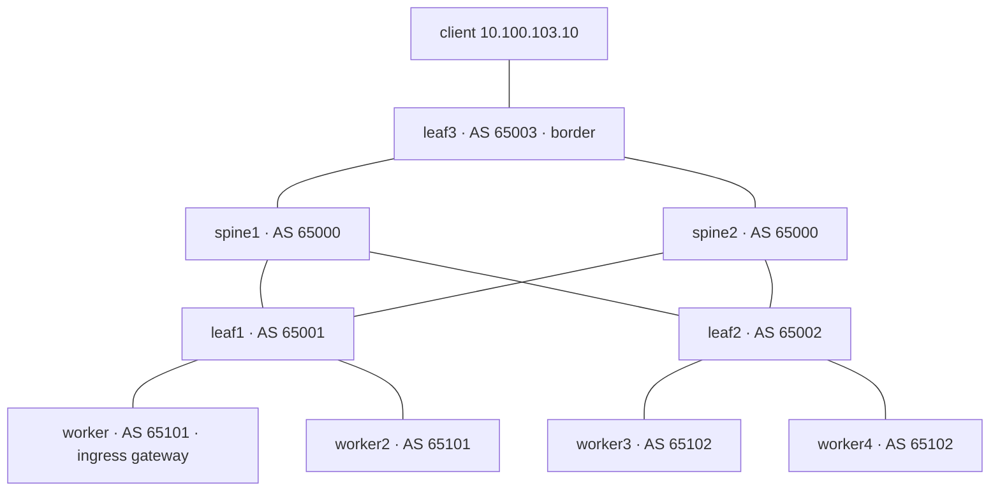

# Announce LoadBalancer IPs over BGP from a spine-leaf fabric

> Bare-metal clusters have no cloud load balancer. Here, MetalLB gives a service an IP and
> announces it over BGP to a simulated data-center fabric (FRR spine-leaf), the way real
> racks do it. The service is an Istio ingress gateway that runs on a single node.

**Tested with:** kind v0.33.0 (Kubernetes v1.37.0), FRR 10.6.2, MetalLB 0.16.2, Istio 1.30.8, Flux 2.10.0

> **Status:** the fabric (steps 1 and 2: FRR configs, ECMP, the route guardrail, spine and
> link failure) was tested on Docker. The cluster, Flux, MetalLB and Istio steps (3 to 10)
> have not been run end to end yet. Expect rough edges and open an issue if you hit one.

## Goals

- Build a 2-spine, 3-leaf BGP fabric out of FRR containers.
- Attach Kubernetes nodes to two "racks" and let MetalLB peer with each rack's leaf.
- See an IP that exists on no interface become reachable through ECMP across spines and nodes.
- Compare `externalTrafficPolicy: Cluster` and `Local` by watching what the fabric learns.
- Manage the cluster side with Flux, so changes are commits.

## Requirements

- A Linux host with Docker (the NUC), about 6 GB of free RAM.
- `kind` v0.33+, `kubectl`, `flux`, `jq`, `git`. See [prerequisites](../docs/prerequisites.md).
- A fork of this repo and a GitHub token with `repo` scope (Flux commits to your fork).
- The range `10.100.0.0/16` free on the host. Docker refuses to create overlapping networks.

Run everything from the repo root on the machine that runs Docker.

## Architecture



Every leaf connects to both spines, and spines never talk to each other. Spines share one AS,
each leaf has its own, and each rack of nodes has its own (eBGP everywhere, RFC 7938 style).

| What | Where |
|------|-------|
| Spine ↔ leaf links | `10.100.<spine><leaf>.0/24`: spine is `.2`, leaf is `.3` (e.g. spine1-leaf2 is `10.100.12.0/24`) |
| Rack 1 / rack 2 / border | `10.100.101.0/24`, `10.100.102.0/24`, `10.100.103.0/24`; the leaf is `.2` |
| Workers | `.11` and `.12` in rack 1, `.21` and `.22` in rack 2 |
| LoadBalancer pool | `10.100.200.0/24`. No interface has these; they exist only as BGP routes |
| Ingress gateway VIP | `10.100.200.10` |

Each kind worker keeps its normal NIC for cluster traffic and gets a second one on its rack
network. BGP and the client traffic use the second one. Each link is a Docker network and each
switch is an FRR container, so one host can play the whole data center.

## Steps

### 1. Build the fabric

```bash
./ip-announce/scripts/fabric-up.sh
```

The script is short, read it. It creates the Docker networks, starts five FRR containers
(`spine1`, `spine2`, `leaf1`, `leaf2`, `leaf3`) with their configs from `ip-announce/fabric/`,
and starts a `client` container behind leaf3.

Look at a leaf config:

```bash
cat ip-announce/fabric/leaf1/frr.conf
```

The parts that matter:

- `neighbor SPINES ...`: the two uplinks. eBGP, one AS per leaf.
- `redistribute connected`: the leaf advertises its own subnets, so the rest of the fabric can route to the rack and the client.
- `bgp bestpath as-path multipath-relax` and `maximum-paths 4`: use several equal paths even when their AS paths differ. Without them a leaf keeps only one route.
- `bgp listen range 10.100.101.0/24 peer-group NODES`: accept sessions from any node in the rack, so adding a node needs no switch change.
- `route-map FROM-NODES`: a node may only announce `/32`s from the LoadBalancer pool. A misconfigured node can't hijack other prefixes.

Check that every session is up:

```bash
docker exec leaf1 vtysh -c 'show bgp summary'   # vtysh is FRR's CLI
docker exec spine1 vtysh -c 'show bgp summary'
```

Leaf1 should show two established neighbors (the spines). Spine1 should show three (the leaves).
Then check that the client can reach a rack through the fabric:

```bash
docker exec client ping -c 2 10.100.101.2       # leaf1's rack address
```

### 2. Create the cluster and plug it into the racks

```bash
./ip-announce/scripts/cluster-up.sh
```

This creates the kind cluster (`ip-announce`), then for each worker it adds a NIC on its rack
network and a route for `10.100.0.0/16` via the leaf. The route is what makes replies to the
client go back through the fabric instead of the Docker host. The nodes are labeled `rack=rack1|rack2`,
and `worker` also gets `ingress=true`.

Check the wiring:

```bash
docker exec ip-announce-worker ip -br addr                  # eth1 should have 10.100.101.11
docker exec ip-announce-worker ping -c 2 10.100.101.2       # its leaf
docker exec ip-announce-worker ping -c 2 10.100.103.10      # the client, across the fabric
```

### 3. Hand the cluster to Flux

```bash
export GITHUB_OWNER=<your-github-user>
export GITHUB_TOKEN=<token with repo scope>
flux check --pre                 # cluster and tooling are ready for Flux
flux bootstrap github \
  --owner="$GITHUB_OWNER" --repository=k8s-labs --branch=main \
  --path=ip-announce/flux --personal
```

Bootstrap installs the Flux controllers and commits `ip-announce/flux/flux-system/` to your
fork. From then on Flux reconciles `ip-announce/flux/`, which defines four Kustomizations that
apply in order: `metallb`, `metallb-config`, `istio`, `app`.

```bash
git pull                                  # fetch the commit Flux made
flux get kustomizations --watch           # wait for all four to be Ready (a few minutes)
```

Ctrl-C when they are ready. `kubectl get helmreleases -A` shows the three charts behind them.

### 4. See what MetalLB set up

```bash
kubectl -n metallb-system get pods -o wide
kubectl -n metallb-system get ipaddresspools,bgppeers,bgpadvertisements
```

There are three kinds of pods:

- `controller`: assigns addresses from the pool to services.
- `speaker`: on each node, decides which addresses that node announces.
- `frr-k8s`: runs FRR on each node and holds the BGP sessions.

The control-plane node is excluded from announcing (kind labels it
`exclude-from-external-load-balancers`), so four nodes will announce, not five.

The BGP peers are defined once per rack (`ip-announce/manifests/metallb-config/peers.yaml`)
and picked per node by the `rack` label. Now look at the other side of those sessions:

```bash
docker exec leaf1 vtysh -c 'show bgp summary'   # the two rack-1 nodes appear as dynamic neighbors
docker exec leaf2 vtysh -c 'show bgp summary'
```

To see FRR on a node (`frr-k8s` pods carry one container named `frr`):

```bash
POD=$(kubectl -n metallb-system get pods -l app.kubernetes.io/component=frr-k8s \
  --field-selector spec.nodeName=ip-announce-worker -o name)
kubectl -n metallb-system exec "$POD" -c frr -- vtysh -c 'show bgp summary'
```

### 5. Find the gateway and its address

```bash
kubectl -n istio-ingress get pods -o wide        # one pod, on ip-announce-worker
kubectl -n istio-ingress get svc istio-ingressgateway
```

`EXTERNAL-IP` should be `10.100.200.10`, pinned by an annotation in
`ip-announce/manifests/istio/gateway.yaml`. The pod is pinned to the node labeled `ingress=true`
with a `nodeSelector`, so it runs on exactly one node.

### 6. Follow the route through the fabric

The service has no endpoint on three of the four nodes, yet (with `externalTrafficPolicy: Cluster`)
all four announce it. Look at it from each tier:

```bash
docker exec leaf1 vtysh -c 'show ip route 10.100.200.10/32'   # next hops: 10.100.101.11 and .12
docker exec leaf2 vtysh -c 'show ip route 10.100.200.10/32'   # next hops: 10.100.102.21 and .22
docker exec spine1 vtysh -c 'show ip route 10.100.200.10/32'  # next hops: leaf1 and leaf2
docker exec leaf3 vtysh -c 'show ip route 10.100.200.10/32'   # next hops: spine1 and spine2
```

That is four-way ECMP: two spines, then two leaves, then two nodes per leaf.

### 7. Send traffic from outside

```bash
docker exec client curl -s http://10.100.200.10/ip
```

This goes client → leaf3 → a spine → a leaf → a node → kube-proxy → the gateway pod → httpbin.
The answer is the caller's address as the gateway saw it. It is not `10.100.103.10`: with
`Cluster`, kube-proxy rewrites the source (SNAT) when it forwards to the pod.

One simplification: a node in rack 2 forwards traffic for the pod on `worker` over its normal
cluster NIC, not back through the fabric.

### 8. Check that the load really spreads

Count packets received on each worker's rack NIC while sending 200 requests:

```bash
rx() { for n in worker worker2 worker3 worker4; do
  echo -n "$n=$(docker exec ip-announce-$n cat /sys/class/net/eth1/statistics/rx_packets) "; done; echo; }
rx
docker exec client sh -c 'for i in $(seq 200); do curl -s -o /dev/null http://10.100.200.10/ip; done'
rx
```

All four counters should grow by similar amounts, even though the pod runs on `worker`.
ECMP hashes each connection (the 5-tuple), so one connection sticks to one path.

`fabric-up.sh` gives every router its own hash seed. Linux containers share one kernel, and a
flow keeps the same hash from hop to hop, so with the defaults every tier would choose the same
next hop and some paths would stay idle. This is called hash polarization. We hit it while
testing, and real fabrics have the same problem.

### 9. Switch to `externalTrafficPolicy: Local`

This is a GitOps change: edit, commit, push.

```bash
sed -i 's/externalTrafficPolicy: Cluster/externalTrafficPolicy: Local/' \
  ip-announce/manifests/istio/gateway.yaml
git commit -am "ip-announce: gateway externalTrafficPolicy Local" && git push
flux reconcile kustomization istio --with-source   # don't wait for the next interval
```

MetalLB now announces the address only from nodes that run a ready gateway pod. Repeat steps 6 to 8:

- `leaf1` has one next hop (`10.100.101.11`). `leaf2` has no route from a node anymore.
- `leaf3` still has two paths (one per spine), but they all lead to leaf1.
- Only `worker`'s counter grows.
- `curl http://10.100.200.10/ip` now returns `10.100.103.10`: no SNAT, so the client IP survives.

`Local` keeps the client IP and skips an extra hop. The cost is that traffic only enters through the nodes that run the pod.
Revert with `git revert HEAD && git push` when you are done.

### 10. Break things

Lose a spine. Traffic keeps flowing over the other one:

```bash
docker stop spine1
docker exec leaf3 vtysh -c 'show ip route 10.100.200.10/32'   # one path left
docker exec client curl -s http://10.100.200.10/ip
docker start spine1                                           # sessions come back by themselves
```

Pull a node's "cable". `worker3` loses its rack link, and its leaf notices when the BGP hold
timer (9 s, set in `peers.yaml`) runs out:

```bash
docker network disconnect ia-rack2 ip-announce-worker3
sleep 12
docker exec leaf2 vtysh -c 'show ip route 10.100.200.10/32'  # only worker4 (.22) is left
docker exec client curl -s http://10.100.200.10/ip            # still works
```

Plug it back. Docker forgets the route when the NIC goes away, so add it again:

```bash
docker network connect --ip 10.100.102.21 ia-rack2 ip-announce-worker3
docker exec ip-announce-worker3 ip route replace 10.100.0.0/16 via 10.100.102.2
```

## Verify

```bash
./ip-announce/scripts/verify.sh
```

It checks that all BGP sessions are established, prints the next hops each leaf uses for the
VIP, and requests `/ip` from the client. Run it with the default `Cluster` policy.

## Troubleshooting

- **A session is stuck in `Active` or `Connect`.** Check the node side first: `docker exec ip-announce-worker ip -br addr` should show `eth1` with a `10.100.10x` address, and the node must be able to ping its leaf.
- **Sessions are up but the leaf has no route to the VIP.** The leaf only accepts `/32`s from `10.100.200.0/24`. Compare with `kubectl -n metallb-system get ipaddresspools`.
- **`EXTERNAL-IP` stays `<pending>`.** `kubectl -n metallb-system get ipaddresspools,bgppeers` and the `controller` logs. The `metallb-config` Kustomization must be Ready.
- **The route exists but `curl` hangs.** The return path is broken. After a node restart its route to `10.100.0.0/16` is gone; rerun the `ip route replace` from step 10.
- **One path never gets traffic.** Hash polarization (step 8). Routers built by hand need `fib_multipath_hash_policy=3` and a unique `fib_multipath_hash_seed`.
- **A Kustomization is not Ready.** `flux get kustomizations` shows why. For more, use `kubectl -n flux-system logs deploy/kustomize-controller` or `flux get helmreleases -A`.
- **`docker network create` fails with an overlap.** Another network uses a `10.100.x.x` range. Free it, or change the addresses in the scripts, FRR configs and manifests together.

## Cleanup

```bash
./ip-announce/scripts/cleanup.sh        # deletes the cluster, FRR containers, client and networks
git rm -r ip-announce/flux/flux-system  # drop Flux's own files from your fork
git commit -m "Remove ip-announce Flux install" && git push
```

Then delete the Flux deploy key under your fork's Settings → Deploy keys.

## References

- [MetalLB: BGP configuration](https://metallb.io/configuration/_advanced_bgp_configuration/)
- [MetalLB: external traffic policy](https://metallb.io/usage/#traffic-policies)
- [FRR: BGP](https://docs.frrouting.org/en/latest/bgp.html)
- [RFC 7938: Use of BGP for routing in large-scale data centers](https://www.rfc-editor.org/rfc/rfc7938)
- [Istio: installing gateways with Helm](https://istio.io/latest/docs/setup/additional-setup/gateway/)
- [Flux: bootstrap for GitHub](https://fluxcd.io/flux/installation/bootstrap/github/)
